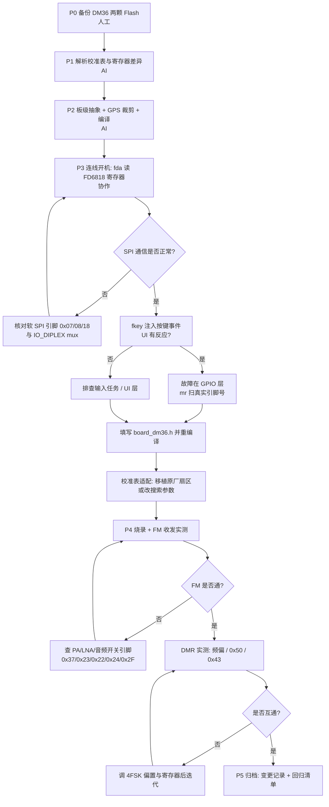

# DM36 移植可行性与执行流程

> 目标设备：DM36（屏幕同 DM32；侧键 PTT / SK1 / SK2 数量相同；无 GPS；无左右 P1/P2 键；RF 芯片 FD6818B；DMR/AMBE 芯片 HR_C7000；外部存储同 DM32）
>
> 本文基于 `docs/` 现有文档与 `src/` 源码静态分析编排，不含任何原厂资料推断。
>
> 当前可用资源（2026-11-25 更新）：已有 DM36 Flash 备份文件并可提供；已有授权许可；射频验证可用另一台电台完成定性收发/互通。

---

## 1. 结论

**可行，但不是零成本移植。**

| 判断维度 | 结论 |
|---|---|
| SoC / CPU | HR_C7000（CK803S）相同，内核与时钟链已跑通 |
| 屏幕 | 240×320 ST7789、I8080 8 位并口相同，`panel.c/.h` 可复用 |
| 程序 Flash / XIP | 已正常启动，地址与固件头无需变动 |
| 数据 Flash | 型号/容量/布局相同，`spi0.c`/`flash.c` 可复用 |
| DMR 引擎 / 声码器 | HR_C7000 相同，DMR/P25/NXDN 核心可复用 |
| **按键** | **引脚号与 pin mux 写死为 DM32，当前完全失效——需适配** |
| **收发** | **FD6818 软 SPI / PA-LNA 引脚、出厂校准表需适配** |
| GPS | 默认关闭，删除不影响收发 |
| P1/P2 | 本固件**无独立 P1/P2 按键**，SK1/SK2 即左右侧键；DM36 缺少 P1/P2 不产生移植工作 |

**现象反推**：开机屏幕正常 ⇒ CPU、时钟、程序 Flash XIP、屏驱动、framebuffer 全部正常。故障被收敛到两个纯板级层：**GPIO 引脚/mux（按键）** 与 **射频前端（收发）**。芯片层面源码头注释本身就是 "FD6818B RF transceiver"（`src/drivers/fd6818.c:30`），因此不是芯片不兼容。

---

## 2. 板级抽象（代码层已完成，见第 9 节）

原本全仓没有 DM32/DM36 型号识别、板级 ID 读取或编译期 `BOARD_*` 分支，所有硬件配置以字面值硬编码。现已建立 `src/board/` 独立目录，DM32 为默认、DM36 为薄覆盖层：

```
src/board/board.h          # 按 BUILD 宏选择映射，默认 DM32
src/board/board_dm32.h     # 原有字面值原样集中
src/board/board_dm36.h     # include dm32 + 只覆盖已知差异
src/board/gps_stub.c       # DM36 无 GPS 时的 API 空实现
```

共享源文件只做"字面值 → 板级宏"的一行替换（13 个文件，共 +82/-66 行），上游更新时冲突面很小。仍需注意的非板级项：

- 镜像头 `BFUV32-V2`（`src/Makefile`）：DM36 是否沿用待实机确认
- 初始化流程固定（`src/app/main.c:93-146`）：无运行时型号判断，靠编译期宏切换

---

## 3. 硬件依赖清单（逐项核对）

### 3.1 按键（当前完全失效，最高优先级）

读取方式为 **GPIO 直读 + 5×4 矩阵软件轮询**，无中断、无 ADC 按键。

```c
// src/drivers/keys.c:44-51
#define PIN_KEY_1    49 // columns
#define PIN_KEY_3    51
#define PIN_KEY_4    52
#define PIN_PTT      43
#define ROWS         5
#define COLUMNS      4
#define ROWS_AS_GPIO 0xFE00 // IO_DIPLEX2: LCD_DB0-DB4
```

| 项目 | DM32 硬编码 | 位置 |
|---|---|---|
| SK1 / SK2 | GPIO 51 / 52（复用列 2 / 列 3） | `src/drivers/keys.c:80-85` |
| PTT | GPIO 43，16×100 µs 防抖 | `src/drivers/keys.c:88-102` |
| 矩阵行 | GPIO 71–75 = LCD DB0–DB4，扫描时 `IO_DIPLEX2 |= 0xFE00` 并占 LCD 总线 | `src/drivers/keys.c:113-148` |
| 行定义 | `PIN_KEYPAD_ROW0=71`, `ROW4=75` | `src/hal/hw.h:123-124` |
| mux / DDR / 上下拉初值 | `IO_DIPLEX0=0xFFFDFD80`, `IO_DIPLEX1=0xFFFFFE07`, `IO_DIPLEX2=0x0FC80100` | `src/hal/gpio.c:67-98` |
| 旋钮 A/B | 0x27 / 0x26（TIMER2 的 1 ms ISR 轮询） | `src/drivers/rotary.c:38-39` |

**最可疑点**：DM36 屏幕相同（I8080 总线正常）但侧键 GPIO 编号或 mux 只要变一个，读到的全是高电平，即"按键完全无反应"。若 DM36 行线不再与 LCD 数据线复用，`ROWS_AS_GPIO` 切换反而会破坏显示。

### 3.2 收发（当前失效，按怀疑度排序）

**1) 出厂校准表找不到（首怀疑）**

FD6818 的 4FSK 偏置、RX 调整、PA 功率 DAC 来自数据 Flash 中的原厂校准扇区，按内容搜索：

```c
// src/services/factory_cal.c:39-42
#define SEARCH_START 0x1000
#define SEARCH_END   0xC9000
#define SECTOR_SIZE  4096
#define SECTOR_TAG   0x02
```

字段偏移：`0x016` 晶振、`0x017/0x0A6` 4FSK 偏置、`0x027` RX 调整、`0x040/0x0D0` PA 功率、`0x20A/B` RX 电平、`0x300/0x328` 校准频点（`src/services/factory_cal.h:35-58`）。找不到时用 `DEFAULT_TABLE[]`（`src/services/factory_cal.c:78-90`，从两台 DM32 抄的折中值）。

`docs/factory-calibration.md:22-23` 记录 issue #142：原厂扇区丢失 → 4FSK 偏置退回 `0xFF` → 频偏大三倍多 → FM 正常但 DMR/P25 有载波对方解不出。DM36 校准数据格式/tag/扇区只要不同，就会静默退化，**现象吻合**。

**2) FD6818 软 SPI 引脚 / 时序**

FD6818 走 GPIO 软件 bit-bang（硬件 SPI0 专用于 25Q128）：

```c
// src/drivers/fd6818.c:45-49
#define PIN_SCL 0x07
#define PIN_SDA 0x08
#define PIN_SCN 0x18
#define PIN_GP0 0x3B
#define PIN_GP1 0x3A
```

写 `delay(5)` / 读 `delay(10)`（`fd6818.c:191-229`）。PA/LNA/音频开关：

```c
// src/services/radio_internal.h:49-54
#define PIN_LNA_VHF  0x22 // R5_V_SW
#define PIN_LNA_UHF  0x24 // R5_U_SW
#define PIN_PA_VHF   0x37
#define PIN_PA_UHF   0x23
#define PIN_AUDIO_SW 0x2F
```

**3) FD6818B 寄存器差异**

代码无运行时芯片 ID 校验，但 `docs/fd6818-registers.md:32-36` 已有跨机型差异证据：另一台机 `0x47` 高位为 `0x7840/0x7040`，本机为 `0x6042/0x6142`。DMR 关键位：`0x50=0xBB20`（bit15 把原始基带送 HR_C7000，否则无 DMR 同步）、`0x43=0x4048`（DMR 带宽），见 `src/drivers/fd6818.c:131-135, 387-392`。

**4) HR_C7000 侧**

`modem.c` 的 `RF_MODE=0x03269860`、`RF_CONTROL=0x00041F0A`、`SIG_CENTER`、DAC B 偏置来自原厂；`src/dmr/hr_c7000.c:2943-2956` 记录"重复软复位会永久搞死 DMR 接收"。**在 FD6818 通信打通前不要动这里**。

### 3.3 GPS（可安全裁剪）

- 默认 `settings.gps = 0`（`src/services/settings.c:107` → `GPS_MODE_NOT_DETECTED`），GPS 接收机默认不开启
- `src/app/main.c:132` 无条件调用 `gps_start()`，但只注册任务与 UART1，不开接收中断
- 占用资源：电源 GPIO `0x2C`（`src/services/gps.c:59`）、UART1 基址 `0x14040000`、IRQ 10
- 不能只删 `main.c` 那一行：菜单仍会调 `gps_set_enabled()`，会访问不存在的 GPIO/UART。需同时处理 `src/app/gps_screen.c:137-142`、`src/app/general_options.c:258-286`，并给 `gps_read()/gps_has_fix()/gps_position()` 加存根

### 3.4 存储与屏幕（无需改动）

- 两颗 Flash：程序 Flash（XIP `0x0300C000`）与数据 Flash（25Q128，16 MB，SPI0 `0x140A0000`，CS GPIO `0x12`）。JEDEC 白名单 `src/drivers/flash.c:159-172`，容量固定 `0x1000000`
- 屏幕：`src/drivers/panel.h:35-44` 硬编码 240×320 / ST7789 / BGR565；`panel.c` 无屏型号检测，直接写固定初始化序列。DM36 屏幕相同则整条链可复用

---

## 4. AI 自动化 vs 人工操作分工

### 4.1 AI 可完全自动化（纯代码/数据分析，不碰设备）

| 工作 | 具体产出 |
|---|---|
| 建立板级抽象层 | `board.h` + `board_dm36.h`，收敛所有硬编码引脚/mux，DM32 构建保持等价 |
| GPS 裁剪 | 条件编译 `gps_start()`、GPS 菜单/屏幕，补存根函数 |
| 校准数据解析 | 写脚本按 tag 与 BCD 频点搜索 DM36 备份，输出 DM32/DM36 字段差异报告 |
| 寄存器 dump 解读 | 对比 `fda` dump 与 BK4819 默认值 / `fdc` 缓存，列出差异寄存器与建议值 |
| 编译验证 | 在 `src/` 执行 `make`，修编译错误，检查 `.map` |
| 扩展诊断脚本 | 例如"按住键时自动轮询全部 `GPIO_EXT` 找变化位"，基于 `dm32dbg.py mr` 通道 |
| 文档与清单 | 变更记录、回归测试用例、核对表 |

### 4.2 AI 出命令 + 人工执行物理动作（协作）

| 工作 | AI 负责 | 人工负责 |
|---|---|---|
| Flash 备份/烧录 | 给准确命令、校验输出、判断成败 | 插线、确认 COM 口、**关机→运行→30 秒内开机（不按键）** 时序、决定何时写（`tools/backup/dm32_dump.py:15-17`） |
| 寄存器/GPIO 读取 | 给 `fdr`/`fda`/`mr` 命令序列并解读；经授权也可直接运行 | 连线、开机保持在线、按住 PTT/SK1/SK2 |
| 分层定位按键故障 | 运行 `tools/debug/fkey.py` 向 UI 队列注入 SK1/PTT 事件：若 UI 有反应 ⇒ 输入任务/UI 正常，问题必在 GPIO 层 | 保持连接、观察屏幕反馈 |
| 截图确认 UI | 运行 `tools/debug/fshot.py` 读 framebuffer 生成 PNG 并分析 | 确认当前应显示什么界面 |
| 工具链准备 | 检查安装状态、配 PATH | 玄铁 CDS 注册账号、下载许可证（`README.md:66-69`） |

### 4.3 仍需人工确认

1. **目视/手感确认**：屏幕、背光、按键手感、PTT 防抖；静态截图可由 AI 分析
2. **另一台电台配合**：完成 FM/DMR 定性收发与互通确认
3. **CPS 行为确认**：人工提供可观察的 CPS 表现后，AI 回填机型码 `BOARD_CPS_RADIO_TYPE`

---

## 5. 编排流程



### P0 — 资料与备份（人工，阻塞后续全部步骤）

| 项 | 内容 |
|---|---|
| 目标 | 保住 DM36 原厂校准数据与可回退镜像 |
| 操作 | `py tools/backup/dm32_dump.py COM6 data backup/dm36/dm36_25q128.bin`（16 MB，约 11 分钟）；再备份 program flash；每颗读两遍比对 |
| 关键约束 | 电台关机 → 启动命令 → **30 秒内开机且不按键**（黑屏、LED 灭）；跑着 OpenDMR 时必须先关机 |
| 交付 | 两份 bin 文件 + DM36 原理图/BOM（若有） |
| 当前条件（2026-11-25） | 用户已有备份文件并可提供 |

### P1 — 离线数据分析（AI）

| 项 | 内容 |
|---|---|
| 输入 | P0 的 bin 文件 |
| 操作 | 扫描数据 Flash 中扇区末字节 `0x02` 且 `0x300/0x328` 首频点落在 UHF/VHF 范围的扇区；解析各字段并与 `DEFAULT_TABLE[]` 对比；检查是否存在 `0x10000` 副本 |
| 交付 | 校准表地址/格式报告；DM32 vs DM36 差异表；是否可直接复用现有搜索逻辑的结论 |
| 验收 | 能明确回答"现有 `factory_cal.c` 能否找到 DM36 的表" |

### P2 — 代码适配（AI）

| 项 | 内容 |
|---|---|
| 操作 | ① 抽 `board.h` / `board_dm36.h`，DM32 保持原值；② 按 P1 结论适配校准搜索/字段；③ 条件编译掉 GPS 菜单、`gps_start()`、存根 GPS 读取；④ `make` 编译并检查 `.map` |
| 交付 | 可编译的 DM36 分支固件；逐项变更清单 |
| 验收 | DM32 构建结果与基线一致；DM36 构建无编译错误 |

### P3 — 分层定位（协作，按此顺序避免盲目改动）

1. **FD6818 是否活着**：`py tools/debug/dm32dbg.py fdr 0x00`、`fda --save dm36.txt`，对照 `docs/fd6818-registers.md` 的 BK4819 复位默认值（0x71=0x8517、0x44=0x9009 等）。全 0 ⇒ 软 SPI 引脚/mux 不对，先查 0x07/0x08/0x18
2. **按键故障分层**：`py tools/debug/fkey.py sk1` / `ptt` 注入 UI 事件。UI 有反应 ⇒ 输入任务与 UI 正常，问题在 GPIO 层；无反应 ⇒ 查 `input.c`/UI
3. **定位真实引脚**：人工按住 PTT/SK1/SK2，AI 用 `mr` 读 `GPIO_EXT`。地址算法（`src/hal/hw.h:65-71`）：pin 32–63 时 `GPIO_EXT = 0x14100050`，PTT(43)=bit11、SK1(51)=bit19、SK2(52)=bit20
4. **回写配置**：把实测引脚号填入 `board_dm36.h`，重新编译

### P4 — 实机烧录与射频验证（人工执行，AI 调参）

| 阶段 | 判定点 | 失败时排查 |
|---|---|---|
| 烧录 | `fw_update.py` 增量升级或 `dm32_dump.py --write` | 确认型号头、起始地址 0xC000 |
| FM 收发 | 用另一台电台做定性收听/发射：能听到信号、对方能收到 | 查软件寄存器/板级宏：PA/LNA 引脚 0x37/0x23/0x22/0x24、音频开关 0x2F、`0x47` 音频输出位 |
| DMR 收发 | 与另一台电台定性互通、能解码 | 4FSK 偏置（校准表）、`0x50=0xBB20` 基带位、`0x43=0x4048` 带宽、`hr_c7000` 同步表 |
| 回归 | 扫描、双守、联系人、字库 | 存储布局与 DM32 相同，理论上全部可用 |

### P5 — 归档（AI + 人工确认）

更新本文档的"实测结果"章节；提交 `board_dm36.h` 与变更清单；记录 DM36 专属校准地址与寄存器差异；列出仍未解决项。

---

## 6. 核对清单

### 按键

- [ ] PTT 实际 GPIO（DM32 = 43）
- [ ] SK1 / SK2 实际 GPIO（DM32 = 51 / 52）
- [ ] 矩阵行是否仍复用 LCD DB0–DB4；若是，`IO_DIPLEX2` 掩码值
- [ ] `IO_DIPLEX0/1/2`、GPIOA/B/C DDR/DR、上下拉初值
- [ ] 旋钮 A/B 引脚与 TIMER2 轮询
- [ ] 键盘背光 `0x28`、LED 32/33
- [ ] `UI_KEY_*` 与 `KEYS_*` 位号对齐（若键位数量变化）

### 射频

- [ ] FD6818 软 SPI：SCL 0x07 / SDA 0x08 / SCN 0x18 + mux
- [ ] GP0/GP1 0x3B / 0x3A
- [ ] PA/LNA：0x37 / 0x23 / 0x22 / 0x24；MIC_MUT 0x2E；AUDIO_SW 0x2F；AUDIO_AMP 0x35
- [ ] 校准扇区 tag、地址范围、字段偏移、频率 BCD 格式
- [ ] 0x50 基带位、0x43 带宽、0x47 音频输出、0x73 AFC
- [ ] `modem.c` 的 `RF_MODE` / `RF_CONTROL` / `SIG_CENTER` / DAC 偏置（最后再动）

### 其他

- [ ] GPS 裁剪完整（菜单、屏幕、`gps_start()`、存根）
- [ ] 型号字符串与镜像头（`firmware_info.c`、`cable_link.c`、`Makefile`、`mkboot.py`）
- [ ] 程序 Flash 起始地址 `0x0300C000` 与升级头
- [ ] 数据 Flash JEDEC ID 白名单与容量
- [ ] 电池 ADC 系数 `ADC_PER_VOLT_X100 = 82`（`src/services/battery.c:45`，标注为 DM-32）

---

## 7. 调试命令速查

| 用途 | 命令 |
|---|---|
| 构建 DM32（默认） | `cd src; make` → `build/opendmr.bin` |
| 构建 DM36 | `cd src; make BOARD=dm36` → `build/opendmr_dm36.bin` |
| 备份数据 Flash | `py tools/backup/dm32_dump.py COM6 data backup/dm36/dm36_25q128.bin` |
| 烧录固件 | `py tools/backup/dm32_dump.py COM6 program src/build/opendmr.bin --write --start 0xC000` |
| 增量升级 | `py tools/debug/fw_update.py src/build/opendmr.bin --port COM6` |
| 读 FD6818 寄存器 | `py tools/debug/dm32dbg.py fdr 0x0c` |
| 全量 dump FD6818 | `py tools/debug/dm32dbg.py fda --first 0 --count 0x80 --save dm36.txt` |
| 对比寄存器缓存 | `py tools/debug/dm32dbg.py fdcdiff dm32cache.txt dm36.txt` |
| 读内存/GPIO | `py tools/debug/dm32dbg.py mr 0x14100050 4 --width 4` |
| 注入按键 | `py tools/debug/fkey.py sk1`（支持 `sk2`/`ptt`/`rot:3`/`long:green`） |
| 截图 | `py tools/debug/fshot.py shot.png --scale 2` |
| 机型信息 | `py tools/debug/dm32dbg.py info` |

---

## 8. 实测结果记录（待填）

| 阶段 | 日期 | 结果 | 备注 |
|---|---|---|---|
| P0 备份 | 2026-11-25 | 已有备份文件 | 用户可提供 |
| P1 校准解析 | — | 待备份文件分析 | 依赖 P0 bin |
| P2 编译 | 2026-11-25 | 通过 | DM36 `BUILD_EXIT=0`；工具链与目录见 9.4/9.6 |
| P3 FD6818 通信 | — | 待软件 dump | 采集 `fda`/`fdcdiff` |
| P3 按键引脚 | — | 待 `mr` 实测 | 人工按键、AI 读 `GPIO_EXT` |
| P4 FM 收发 | — | 待定性测试 | 另一台电台定性收发 |
| P4 DMR 互通 | — | 待定性测试 | 另一台电台定性互通 |
| P5 归档 | — | 持续更新 | 本文即剩余工作记录 |

---

## 9. 已完成的代码层适配（2026-11-25）

### 9.1 设计原则

- **DM32 是默认**：不传 `BOARD` 时构建结果与改造前逐值等价
- **DM36 全在 `src/board/`**：型号映射、差异覆盖、无 GPS 存根都不混入业务目录
- **上游冲突最小化**：共享文件每处只做一行"字面值 → 宏"替换，共 13 个文件 +82/-66 行

### 9.2 新增文件

| 文件 | 作用 |
|---|---|
| `src/board/board.h` | 按 `BOARD_DM36` 选择映射；`hw.h` 自动包含它 |
| `src/board/board_dm32.h` | 60 个板级宏，原样转录原字面值 |
| `src/board/board_dm36.h` | `#include "board_dm32.h"` + 覆盖 `BOARD_NAME="DM-36"`、`BOARD_HAS_GPS=0`；待实测项集中在 `TODO(DM36)` 注释里 |
| `src/board/gps_stub.c` | DM36 下替代 `services/gps.c`，5 个 GPS API 空实现 |

### 9.3 已改造的共享文件（仅宏替换）

`hw.h`（引脚）、`gpio.c`（mux/DDR/DR 初值，GPS 电源脚按机型裁剪）、`keys.c`（列/PTT/矩阵）、`rotary.c`、`leds.c`、`fd6818.c`（软 SPI）、`radio_internal.h`（PA/LNA/频段）、`gps.c`、`rda5807.c`、`battery.c`、`firmware_info.c`、`cable_link.c`、`Makefile`。

### 9.4 构建方式

已验证的工具链放在项目内：

- 编译器：`toolchain/MinGW/csky-elf-noneabiv2-tools/bin`
- make：`toolchain/MinGW/msys/1.0/bin`

在仓库根目录执行：

```powershell
$env:PATH = "E:\peng\OpenDMR\toolchain\MinGW\csky-elf-noneabiv2-tools\bin;E:\peng\OpenDMR\toolchain\MinGW\msys\1.0\bin;$env:PATH"
cd src
make clean
make CROSS=csky-elf-noneabiv2-            # DM32 → build/opendmr.bin
make CROSS=csky-elf-noneabiv2- BOARD=36   # DM36 → build/opendmr_dm36.bin（BOARD=dm36 亦可）
```

`CROSS=csky-elf-noneabiv2-` 必须显式传入：Makefile 默认值仍是上游的 `csky-elfabiv2-`，那套是 Minilibc，缺少 `reent.h`，不能编译当前固件。

DM36 构建从源列表剔除 `services/gps.c`、加入 `board/gps_stub.c`；不编译 GPS 服务、不注册 UART1、不触碰 GPS 电源脚。GPS 菜单和屏幕仍可显示但只读、无副作用，无需改 UI 代码。

### 9.5 验证状态

| 检查 | 结果 |
|---|---|
| 宏定义完整性 | 59 个引用全部有定义（未使用项仅 include guard） |
| 裸引脚字面值残留 | `grep '^#define PIN_.* 0x?[0-9]'` 无命中 |
| 裸 `gpio_output(0x..)` 残留 | 无命中 |
| DM32 行为等价 | 逐值核对通过，未改逻辑 |
| Git 子模块 | 已执行 `git submodule update --init`，`vocoder`、`p25` 已拉取 |
| **实际编译** | **通过**：使用 C-SKY V3.10.30 Newlib abiv2 / GCC 6.3.0（`csky-elf-noneabiv2-gcc`）完整编译 DM36 成功，`BUILD_EXIT=0` |
| **源码问题** | 已修复 `src/board/board_dm36.h:46` 注释中的 `*/` 提前闭合问题 |
| **实机功能** | **未执行**：待 P0 备份与 P3 测量 |

### 9.6 编译环境问题与工具链下载（2026-11-25）

#### 问题现象

- `README.md:66` 写的是“玄铁 Xuantie-800 GCC 13.3.0（csky-elfabiv2）”，但公开下载的 CDS 5.2.21 / 5.2.32 中，`csky-elfabiv2-tools` 实际是 **Minilibc/6.3.0**。
- 该工具链没有 `reent.h`，编译 `src/hal/newlib.c` 时报 `fatal error: reent.h: No such file or directory`。
- `csky-elfabiv2-*` 是 Minilibc 前缀；C-SKY 800 带完整 newlib 的裸机工具链前缀是 `csky-elf-noneabiv2-`。

#### 调查结论

- 玄铁 CPU 软件开发指南 V3.3 明确写明 CSKY 系列工具链发布版本基于 **GCC 6.3**。
- 未找到公开可下载的 `csky-noneabiv2` / `csky-elf-noneabiv2` **GCC 13.3.0 + newlib** 官方包；README 的 GCC 13.3.0 描述与当前公开 C-SKY 800 工具链不符。
- 实测 `C-SKY V3.10.30 Newlib abiv2 / GCC 6.3.0` 含 `reent.h`、支持 `-mcpu=ck803s`，可以完整编译 DM36。

#### 下载链接

| 资源 | 地址 |
|---|---|
| 玄铁 GCC-800 工具链 V3.10.30 下载页（需登录） | https://www.xrvm.cn/community/download?id=4224178809689149440 |
| 官方 V3.10.30 Release Note（包名与 MD5） | https://occ-oss-prod.oss-cn-hangzhou.aliyuncs.com/resource//1678185528238/ReleaseNote.pdf |
| 玄铁 CPU 软件开发指南 V3.3 | https://occ-oss-prod.oss-cn-hangzhou.aliyuncs.com/resource//1721094254407/%E7%8E%84%E9%93%81CPU%E8%BD%AF%E4%BB%B6%E5%BC%80%E5%8F%91%E6%8C%87%E5%8D%97V3.3.pdf |
| CDS V5.2.21 软件包下载页（README 原链接，msys/make 来源） | https://www.xrvm.cn/community/download?versionId=4498138066258563072 |
| GitHub 直链镜像（旧版 Windows newlib 包，可选） | https://github.com/crosstyan/Xuantie-800-gcc-elf-newlib-prebuilt/releases/download/v0.00/csky-elf-noneabiv2-tools-mingw-newlib-20210423.tar.gz |

#### 推荐包与本地目录

在 V3.10.30 下载页选择：

```text
csky-elf-noneabiv2-tools-mingw-newlib-20230301.tar.gz
MD5: 052e4f556f6a56048258fbfb8ae4c234
```

已复制到项目内：

```text
toolchain/MinGW/csky-elf-noneabiv2-tools/bin
toolchain/MinGW/msys/1.0/bin
```

验证命令与结果：

```powershell
& toolchain\MinGW\csky-elf-noneabiv2-tools\bin\csky-elf-noneabiv2-gcc.exe --version
& toolchain\MinGW\msys\1.0\bin\make.exe --version
```

```text
T-HEAD C-SKY Tools V3.10.30 Newlib abiv2 B20230301 6.3.0
GNU Make 3.81
BUILD_EXIT=0
text 728512 / data 3444 / bss 321908
```

Git 子模块已初始化（2026-11-25 执行 `git submodule update --init` 成功）。

### 9.7 下一步（需实测/数据后回填）

1. 依据 P3 `mr` 实测结果，把引脚号填入 `board_dm36.h` 对应宏
2. 若 FD6818 校准表格式不同，修改 `factory_cal.c`——依赖 P1 备份解析结果
3. 确认 DM36 升级头：已有备份 bin，待离线分析后确认；当前沿用 `BFUV32-V2`
4. 确认 CPS 机型码 `BOARD_CPS_RADIO_TYPE`：待人工观察到 CPS 行为后填写；当前沿用 11

---

## 10. 剩余工作记录（持续更新）

> 从本节起，本文作为 DM36 剩余工作的主记录；后续进展只更新本节与“8. 实测结果记录”。

### 10.1 当前可用资源

| 项 | 状态 |
|---|---|
| DM36 Flash 备份 | 已有，用户可提供；待校验 |
| 授权许可 | 用户已说明具备 |
| 软件调试通道 | 可用时走 `fdr`/`fda`/`fdcdiff`/`mr`/`fkey`/`fshot` |
| 射频互通验证 | 另一台电台定性收发/互通 |
| 编译环境 | 已就绪并完成 DM36 构建，见 9.4/9.6 |

### 10.2 剩余任务

| 编号 | 任务 | 负责 | 输入 / 前置 | 状态 | 下一步 |
|---|---|---|---|---|---|
| R1 | 校验/解析 DM36 Flash 备份 | AI + 人工提供 | 备份 bin | 待用户提供 | 校验数据/程序 Flash，定位校准扇区 |
| R2 | P1 校准表解析 | AI | R1 | 待 R1 | 输出地址/格式报告，判断 `factory_cal.c` 是否需改 |
| R3 | FD6818 软件 dump 解读 | AI | `fda`/`fdcdiff` 输出 | 待采集 | 人工连接串口后采集，AI 对照默认值分析 |
| R4 | 按键 GPIO 定位 | 协作 | 串口 + 人工按键 | 待执行 | AI 用 `mr` 读 `GPIO_EXT`，人工按 PTT/SK1/SK2 |
| R5 | 回填 `board_dm36.h` | AI | R3/R4 结果 | 待结果 | 回填有实测证据的引脚/mux 值 |
| R6 | `factory_cal.c` 适配 | AI | R2 结果 | 待结果 | 若校准格式不同再改，保持 DM32 等价 |
| R7 | 定性收发/互通测试 | 人工执行 + AI 调参 | R5/R6 固件 + 另一台电台 | 待执行 | 完成可听/可解码/可互通判断 |
| R8 | 文档/清单归档 | AI | 以上结果 | 持续 | 更新本节与“8. 实测结果记录” |

---

## 11. 按键对应检测

按键对应按“两层定位”：先确认 UI/输入任务，再读 GPIO 实际状态。

### 11.1 UI 层验证

```powershell
py tools/debug/fkey.py sk1
py tools/debug/fkey.py sk2
py tools/debug/fkey.py ptt
```

判定：

- 屏幕有按键反应：UI 与输入任务正常，继续 GPIO 定位
- 屏幕无反应：先查 `input.c` / UI 层

### 11.2 GPIO_EXT 读取

地址算法来自 `src/hal/hw.h:66-72`：

```text
GPIO_EXT(pin) = GPIO_BASE(pin) + 0x50
```

| Bank | pin 范围 | `GPIO_EXT` 地址 |
|---|---|---|
| GPIO A | 0–31 | `0x14020050` |
| GPIO B | 32–63 | `0x14100050` |
| GPIO C | 64–95 | `0x14110050` |

读取命令，假设串口为 `COM6`：

```powershell
py tools/debug/dm32dbg.py --port COM6 mr 0x14020050 4 --width 4
py tools/debug/dm32dbg.py --port COM6 mr 0x14100050 4 --width 4
py tools/debug/dm32dbg.py --port COM6 mr 0x14110050 4 --width 4
```

### 11.3 采样与换算

对每个按键：

1. 不按键，连续读 3 次，记为空闲值
2. 人工按住 PTT / SK1 / SK2，连续读 3 次
3. 松开，再读 3 次
4. 比较按住时变化的 bit

换算公式：

```text
pin = bank 起始 pin + bit 序号
```

读 `0x14100050` 时属于 GPIO B，起始 pin 为 32。DM32 参考值：

| 按键 | 变化 bit | 换算 | pin |
|---|---|---|---|
| PTT | bit11 | 32 + 11 | 43 |
| SK1 | bit19 | 32 + 19 | 51 |
| SK2 | bit20 | 32 + 20 | 52 |

DM36 以实测结果为准。例如按住 PTT 时 `0x14100050` 的 bit13 变化，则：

```text
PTT = 32 + 13 = 45
```

### 11.4 矩阵键

PTT、SK1、SK2 通常是直接 GPIO。

数字键、`*`、`#`、方向键可能走矩阵。矩阵键按住时可能同时看到两个 bit 变化：一个行、一个列。这类按键需要同时对照：

- `src/hal/keys.c`
- `IO_DIPLEX0/1/2`
- `GPIOA/B/C DDR/DR`
- `src/board/board_dm32.h` / `src/board/board_dm36.h`

### 11.5 回填配置

拿到有实测证据的引脚号后，回填 `src/board/board_dm36.h` 对应宏，再按 9.4 的命令重新编译 DM36 固件。

---

## 12. Ubuntu 26.04 开发环境安装

### 12.1 安装系统开发包

仅编译固件：

```bash
sudo apt update
sudo apt install -y build-essential git
```

编译并使用 `tools/` 下的调试、备份、截图脚本：

```bash
sudo apt update
sudo apt install -y \
  build-essential \
  git \
  python3 \
  python3-pip \
  python3-serial \
  python3-pil \
  python3-numpy
```

| 包 | 用途 |
|---|---|
| `build-essential` | `make`、GCC、binutils |
| `git` | 子模块与版本信息 |
| `python3` | 所有 `tools/*.py` |
| `python3-serial` | `dm32dbg.py`、`dm32_dump.py`、`fw_update.py` |
| `python3-pil` | `fshot.py`、`mkboot.py`、`mkfont.py` |
| `python3-numpy` | `miclevel.py` |

串口权限：

```bash
sudo usermod -aG dialout $USER
```

执行后重新登录。串口设备通常是 `/dev/ttyUSB0` 或 `/dev/ttyACM0`。

### 12.2 安装 Linux x86_64 C-SKY newlib 工具链

下载页：

```text
https://www.xrvm.cn/community/download?id=4224178809689149440
```

选择包：

```text
csky-elf-noneabiv2-tools-x86_64-newlib-20230301.tar.gz
MD5: 93f5f03c725d09f6f590a9380870e844
```

校验下载文件：

```bash
md5sum csky-elf-noneabiv2-tools-x86_64-newlib-20230301.tar.gz
```

解压与 PATH：

```bash
mkdir -p ~/opt/csky
tar -xzf csky-elf-noneabiv2-tools-x86_64-newlib-20230301.tar.gz -C ~/opt/csky
export PATH="$HOME/opt/csky/csky-elf-noneabiv2-tools/bin:$PATH"
```

若解压后的目录名不同，以包含 `bin/csky-elf-noneabiv2-gcc` 的实际目录为准。

验证：

```bash
csky-elf-noneabiv2-gcc --version
csky-elf-noneabiv2-gcc -dumpmachine
```

### 12.3 编译 DM36

Ubuntu 下直接使用系统 `make`，无需额外 make 工具：

```bash
cd src
make clean
make CROSS=csky-elf-noneabiv2- BOARD=36
```

### 12.4 调试命令

Ubuntu 下使用 `python3`，串口使用 Linux 设备名：

```bash
python3 tools/debug/dm32dbg.py --port /dev/ttyUSB0 mr 0x14100050 4 --width 4
DM32_PORT=/dev/ttyUSB0 python3 tools/debug/fkey.py sk1
```

按键检测流程见第 11 节。

### 12.5 调试脚本 PATH 适配

`tools/debug/dm32dbg.py` 中的 `NM` 改为从 PATH 查找工具链：

```python
NM = os.environ.get('CSKY_NM', 'csky-elf-noneabiv2-nm')
```

这样 `fkey.py` 等依赖 `dm32dbg.NM` 的脚本可以直接使用 PATH 中的 `csky-elf-noneabiv2-nm`。

使用 `tools/release/make_release.py` 时，让 `csky-elf-noneabiv2-*` 和 `make` 都在 PATH 中即可。
